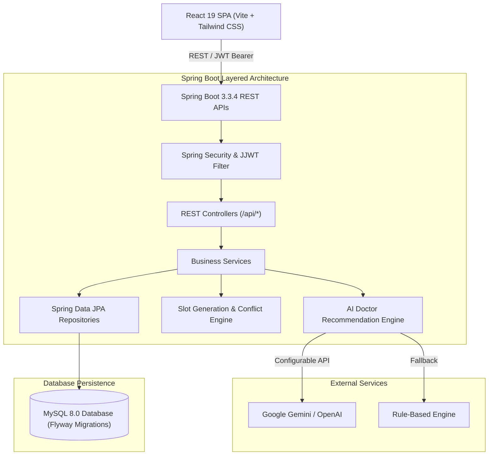
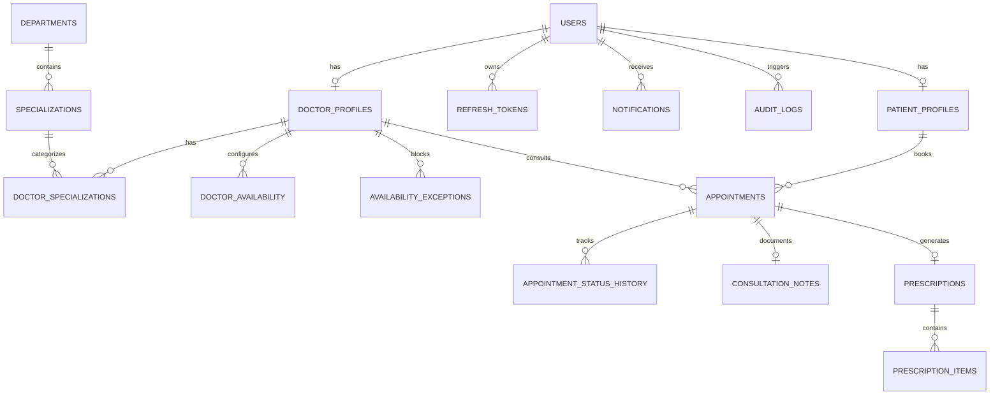

# Smart Healthcare Appointment System with AI-Powered Doctor Recommendation

An enterprise-grade, modern healthcare platform featuring patient discovery, doctor appointment scheduling with double-booking prevention, clinical SOAP consultation notes, digital prescriptions, and an AI-powered symptom navigator. Built with **React 19 + Tailwind CSS** on the frontend, **Java 21 Spring Boot 3.3.4** on the backend, and **MySQL 8.0** for ACID-compliant persistence.

---

## 🌟 Key Features

### 1. 🏥 Patient Portal
- **Discovery & Search**: Filter doctors by clinical department, specialization, consultation type (In-person / Video), and availability.
- **AI Symptom Navigator**: Describe symptoms in plain English. The AI engine identifies matching departments/specializations and warns immediately if life-threatening emergency symptoms are detected.
- **Interactive Slot Booking**: Real-time calendar slot picker with instant validation.
- **Appointment Management**: View upcoming, completed, and past visits; cancel with configurable cutoff policy.
- **Digital Prescriptions**: Access post-consultation medication lists, dosages, and doctor notes.
- **Live Notifications**: Immediate alerts for booking confirmations, status changes, and cancellations.

### 2. 🩺 Doctor Workspace
- **Availability Management**: Configure weekly shifts per day (start time, end time, slot duration, break times).
- **Time Off & Blocked Dates**: Block leaves, holidays, or specific date ranges.
- **Consultation Management**: View daily and upcoming patient appointments.
- **Clinical Notes & Prescriptions**: Add SOAP notes (Subjective, Objective, Assessment, Plan) and generate structured prescriptions with medicine names, dosages, durations, and instructions.
- **Patient Medical Profile**: Access relevant medical details (blood group, allergies) within authorized consultations.

### 3. 🛡️ Administrator Control Center
- **Executive Analytics**: Live metrics on total patients, verified doctors, appointments breakdown, and revenue.
- **Doctor Credentialing**: Review credentials, license numbers, and approve/reject registrations.
- **Department & Specialization Management**: Create medical departments and assign clinical specializations.
- **Global Appointment Oversight**: Filter and manage appointments clinic-wide.
- **Security Audit Logs**: Immutable trail tracking login events, approvals, bookings, and cancellations.

### 4. 🤖 AI-Powered Healthcare Navigation
- **Pluggable Architecture**: Configurable LLM provider (`GEMINI`, `OPENAI`, or deterministic `RULE_BASED` fallback).
- **Clinical Safety Rules**:
  - Never diagnoses or prescribes treatments.
  - Urgent triage detection (chest pain, stroke signs, difficulty breathing triggers high-priority emergency banner with 911/112 dial recommendations).
  - Matches AI suggestions strictly against active database departments and specializations.
  - Zero downtime fallback if the LLM provider is unreachable or rate-limited.

---

## 🏗️ System Architecture



---

## 🗄️ Database Entity-Relationship Model



---

## 💻 Tech Stack

| Component | Technology | Version |
| :--- | :--- | :--- |
| **Frontend Framework** | ReactJS + Vite | 19.x / 8.x |
| **Styling** | Tailwind CSS | 4.x |
| **Routing** | React Router | 7.x |
| **Icons & Visuals** | Lucide React + Recharts | Latest |
| **HTTP Client** | Axios (with token rotation) | 1.13.x |
| **Backend Framework** | Spring Boot | 3.3.4 |
| **JDK** | Java Development Kit (LTS) | 21 |
| **Database** | MySQL Server | 8.0+ |
| **Database Migrations** | Flyway Migration Engine | 10.x |
| **Security** | Spring Security + JJWT | 0.12.6 |
| **API Documentation** | Springdoc OpenAPI (Swagger UI) | 2.6.0 |
| **Testing** | JUnit 5 + Mockito + AssertJ | Latest |

---

## 🚀 Quick Start Guide

### 1. Prerequisites
- **Java 21 JDK** installed (`java -version`)
- **Node.js 18+** & npm installed (`node -v`)
- **MySQL 8.0+** running locally on port `3306`

### 2. Configure Database & Environment
1. Ensure MySQL service is active.
2. In the project root, copy the environment template:
   ```bash
   cp .env.example .env
   ```
3. Edit `.env` (or `backend/src/main/resources/application.properties`) with your MySQL credentials:
   ```properties
   DB_URL=jdbc:mysql://localhost:3306/smart_health_db?createDatabaseIfNotExist=true&useSSL=false&allowPublicKeyRetrieval=true&serverTimezone=UTC
   DB_USERNAME=root
   DB_PASSWORD=root
   ```
   *(Flyway will automatically create all 16 tables and seed data upon startup!)*

### 3. Start the Backend API Server
```bash
cd backend
$env:JAVA_HOME = "C:\Program Files\Java\jdk-21"  # On Windows PowerShell
.\mvnw.cmd spring-boot:run
```
The backend will launch at **`http://localhost:8080`**.
- **Swagger API Docs**: `http://localhost:8080/swagger-ui.html`
- **OpenAPI JSON**: `http://localhost:8080/v3/api-docs`
- **Actuator Health**: `http://localhost:8080/actuator/health`

### 4. Start the Frontend Application
In a separate terminal:
```bash
cd frontend
npm install
npm run dev
```
Open your browser at **`http://localhost:5173`**.

---

## 🔐 Pre-Seeded Test Credentials

The database comes pre-seeded with sample users for each role:

| Role | Email | Password | Name / Specialization |
| :--- | :--- | :--- | :--- |
| **Administrator** | `admin@smarthealth.com` | `Admin@123` | Clinic Administrator |
| **Doctor** | `dr.sarah@smarthealth.com` | `Doctor@123` | Dr. Sarah Jenkins (Cardiology) |
| **Doctor** | `dr.marcus@smarthealth.com` | `Doctor@123` | Dr. Marcus Chen (Dermatology) |
| **Doctor** | `dr.elena@smarthealth.com` | `Doctor@123` | Dr. Elena Rostova (Pediatrics) |
| **Doctor** | `dr.james@smarthealth.com` | `Doctor@123` | Dr. James Wilson (Orthopedics) |
| **Doctor** | `dr.priya@smarthealth.com` | `Doctor@123` | Dr. Priya Patel (Neurology) |
| **Patient** | `patient.john@smarthealth.com` | `Patient@123` | Johnathan Doe |
| **Patient** | `patient.emily@smarthealth.com` | `Patient@123` | Emily Watson |

*(Quick 1-Click Login buttons are available on the Login page for rapid demonstration).*

---

## ⚡ Concurrency & Double-Booking Prevention

To eliminate race conditions when multiple users attempt to reserve the same doctor slot:
1. **Pessimistic Write Lock**: `appointmentRepository.findByDoctorIdAndSlotWithLock(...)` locks the slot range within a `@Transactional(isolation = Isolation.READ_COMMITTED)` boundary.
2. **Database Unique Constraint**: A compound unique index `uk_doc_slot_active (doctor_id, appointment_date, start_time)` at the MySQL level rejects any concurrent overlapping commit.
3. **Double Verification**: The slot generator evaluates weekly doctor availability and blocked exceptions in real time immediately prior to booking.

---

## 🧪 Running Automated Tests

Run backend unit and integration test suite:
```bash
cd backend
$env:JAVA_HOME = "C:\Program Files\Java\jdk-21"
.\mvnw.cmd test
```

Test coverage includes:
- `EmergencyKeywordDetectorTest`: Verifies life-threatening triage detection and warning flags.
- `RuleBasedRecommendationProviderTest`: Tests deterministic clinical symptom matching.
- `DepartmentMatchingServiceTest`: Validates mapping of LLM recommendations to active DB records.
- `AuthServiceTest`: Verifies registration, password hashing, JWT generation, and disabled account security.
- `AppointmentServiceTest`: Tests slot conflict detection, authorization, and state transitions.
- `SlotGenerationServiceTest`: Verifies recurring weekly availability calculation and break-time exclusion.

Run frontend production build verification:
```bash
cd frontend
npm run build
```

---

## 📜 API Endpoints Overview

| Method | Endpoint | Description | Role Required |
| :--- | :--- | :--- | :--- |
| `POST` | `/api/auth/register` | Register new patient | Public |
| `POST` | `/api/auth/login` | Authenticate user & get JWT | Public |
| `POST` | `/api/auth/refresh` | Rotate access token | Public |
| `GET` | `/api/auth/me` | Fetch authenticated user profile | Any |
| `GET` | `/api/doctors` | Search doctors with filters & pagination | Public |
| `GET` | `/api/doctors/{id}` | Doctor details, specs & reviews | Public |
| `GET` | `/api/doctors/{id}/availability` | Generate slots for doctor & date | Public / Patient |
| `PUT` | `/api/doctors/me/profile` | Update doctor profile & fees | `ROLE_DOCTOR` |
| `PUT` | `/api/doctors/me/availability` | Update weekly shifts & breaks | `ROLE_DOCTOR` |
| `POST` | `/api/ai/doctor-recommendations` | AI symptom analysis & matching | Public / Patient |
| `POST` | `/api/appointments` | Book appointment slot | `ROLE_PATIENT` |
| `GET` | `/api/appointments/my` | List current user appointments | Patient / Doctor |
| `PATCH` | `/api/appointments/{id}/cancel`| Cancel appointment | Patient / Doctor |
| `PATCH` | `/api/appointments/{id}/status`| Update status (COMPLETED/NO_SHOW) | `ROLE_DOCTOR` |
| `POST` | `/api/appointments/{id}/prescription`| Issue consultation prescription | `ROLE_DOCTOR` |
| `GET` | `/api/prescriptions/my` | Get user prescription history | `ROLE_PATIENT` |
| `GET` | `/api/admin/dashboard` | Administrative metrics & stats | `ROLE_ADMIN` |
| `GET` | `/api/admin/doctors` | List doctors with approval status | `ROLE_ADMIN` |
| `PATCH` | `/api/admin/doctors/{id}/approval` | Approve or reject doctor | `ROLE_ADMIN` |
| `GET` | `/api/admin/appointments` | Global clinic appointment ledger | `ROLE_ADMIN` |
| `GET` | `/api/admin/audit-logs` | Immutable audit trail | `ROLE_ADMIN` |

---

## 🛡️ Privacy, Security & Clinical Compliance

- **No Stored Symptom PHI**: Symptom descriptions submitted for AI matching are processed in memory and not logged or persisted to ensure HIPAA/GDPR compliance.
- **Strict Role-Based Access Control**: Server-side checks on all mutating and private clinical records (`PatientService`, `DoctorService`, `AppointmentService`, `PrescriptionService`).
- **Resource-Level Authorization**: Patients can only access their own appointments and prescriptions; Doctors can only access appointments for their own roster.
- **BCrypt Password Hashing**: Passwords stored with BCrypt 12 rounds.
- **Configurable LLM Fallback**: If LLM provider APIs are down or disabled, the application continues to operate seamlessly via the built-in rule engine.
